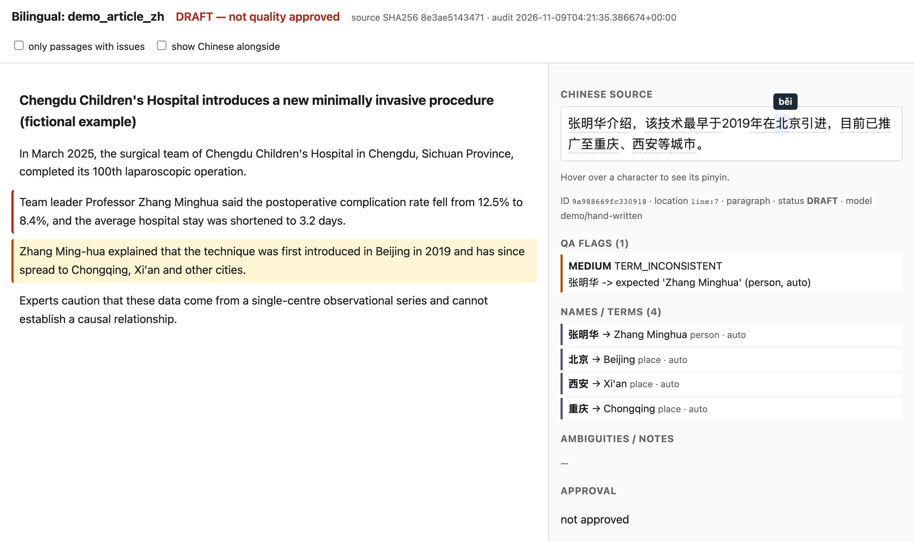
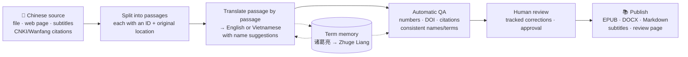
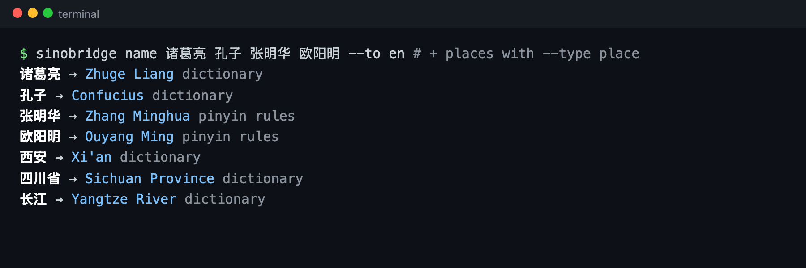
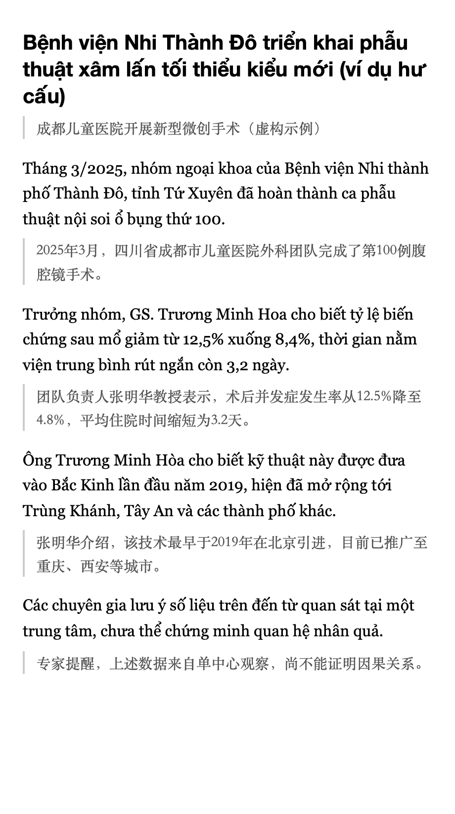

# SinoBridge

**Read, translate and research Chinese documents in English or Vietnamese, with every translated sentence traceable to its exact Chinese source.**

[Tiếng Việt](README.md) · **English**

SinoBridge is an open-source (MIT) toolkit with three parts sharing one core:

| Part | What it does |
|---|---|
| **Sources** (connectors) | Brings in Chinese material from files (TXT, Markdown, DOCX, EPUB, PDF), public web pages (WeChat articles, Zhihu, news, blogs, Wikipedia), pages saved from your browser, video subtitles (Bilibili/Douyin `.srt`/`.vtt`) and citation exports from CNKI/Wanfang/VIP/SinoMed. A plugin interface lets anyone add more sources. |
| **Translate & check** | Translates passage by passage, with context, into **English or Vietnamese** using the model you choose (GPT, Gemini, DeepSeek, Qwen...). Chinese **names and terms** come out in standard forms (pinyin or established English names; Hán-Việt for Vietnamese), and a per-project term memory keeps them consistent from the first chapter to the last. Automatic checks cover numbers, DOIs, citations, terminology and Chinese legal/policy context. Corrections keep their history, and an approval applies only to the exact text that was approved. |
| **Clean output** | EPUB3 with chapters and a table of contents, DOCX, Markdown, translated `.srt`/`.vtt` subtitles, and an offline bilingual review page: click a translated sentence to see its Chinese source, QA flags, notes and revision history. |

*The bilingual review page is a single HTML file that opens offline. Passage 2 has a red border because a number
was mistranslated (4.8% became 8.4%). Passage 3 is selected: the name 张明华 appears as "Zhang Ming-hua" instead of
the agreed "Zhang Minghua". Hovering over 北 shows its pinyin, "běi".*

## How it works

Every translated sentence keeps its passage ID and its location in the original (line, page, block, subtitle timestamp), so you can
always trace it back to the exact Chinese sentence.

## Install

Python 3.10+.

    git clone https://github.com/tuyentran-md/sinobridge.git && cd sinobridge
    python3 -m venv .venv && . .venv/bin/activate
    pip install -e '.[all]'      # includes PDF and DOCX support

## Quick start

Pick the target language when you import a document (`--target en` or `--target vi`; Vietnamese is the default):

    sinobridge sources                                       # list supported inputs
    sinobridge ingest book.epub --workspace work/book --kind book --target en
    sinobridge ingest "https://zh.wikipedia.org/wiki/汉越词" --workspace work/wiki --kind article --target en
    sinobridge ingest video.zh.srt --workspace work/video --kind subtitle --target en

Translate. The default is one passage so you can check the result first; `--max-segments 0` translates everything. Text is only sent to a
service when you pass `--allow-external`, after checking the document's rights and privacy:

    export GEMINI_API_KEY=...        # or OPENAI_API_KEY, DEEPSEEK_API_KEY, DASHSCOPE_API_KEY...
    sinobridge translate --workspace work/book --provider gemini --model <flash-model> --allow-external --dry-run
    sinobridge translate --workspace work/book --provider gemini --model <flash-model> --allow-external --max-segments 0
    sinobridge translate --workspace work/book --provider openai --model <gpt-model> --allow-external

The model is your choice: `openai`, `gemini`, `deepseek`, `qwen`, `openrouter`, `ollama`, or any OpenAI-compatible server
(`--provider openai-compatible --base-url ...`). See `.env.example`.

## Chinese names and terms

- **English**: established forms come from about 17,000 CC-CEDICT proper nouns (Confucius, Tibet, Hong Kong, Yangtze River). Other names
  follow Hanyu Pinyin conventions:
  - people are written surname first, with the given name as one word (张明华 → Zhang Minghua);
  - compound surnames stay together (欧阳 → Ouyang), and surname readings are used (单 → Shan);
  - places are written as one word, with apostrophes where needed (Xi'an), plus an English administrative noun (Sichuan Province).
- **Vietnamese**: Hán-Việt readings, looked up first in a bundled lexicon of about 11,600 entries from Wiktionary and CVDICT, then built
  syllable by syllable with readings ranked by real usage and chosen by pinyin. On names held out from building the data, 88% come out
  fully correct and 95% of syllables are correct.
- Polyphonic characters (乐 lè/yuè, 重 zhòng/chóng) are flagged for review, never silently resolved.
- During translation, the model receives the known names in each passage and must list the names and terms it used. Chinese-origin names
  are normalized to the standard form for the target language. Foreign names written in Chinese characters (特朗普) keep their original
  form (Trump).
- The **term memory** (`terms.json`) holds one agreed rendering per name or term. The audit reports `TERM_INCONSISTENT` when a passage
  differs from it.

      sinobridge name 诸葛亮 张明华 --to en                       # Zhuge Liang · Zhang Minghua
      sinobridge name 四川省 西安 --to en --type place             # Sichuan Province · Xi'an
      sinobridge terms scan --workspace work/book                  # known names in the book, no model needed
      sinobridge terms set 诸葛亮 "Kongming" --type person --workspace work/book   # lock your own choice
      sinobridge terms list --workspace work/book

## Check, review, correct, approve

    sinobridge audit  --workspace work/book --glossary examples/glossary.sample.json
    sinobridge export --workspace work/book --format html --out out/review.html
    sinobridge revise --workspace work/book --segment <ID> --text "Corrected sentence" --reviewer "Lan" \
                      --reason "Number 58 -> 85" --severity HIGH
    sinobridge approve --workspace work/book --segment <ID> --reviewer "Lan" --evidence "Checked against source"

Numbers are compared by value, not by string:
- separators: 1.25 = 1,25;
- scale words: 120万 = 1.2 million = 1,2 triệu;
- month names: 2025年3月 = March 2025;
- Chinese numerals: 一百二十 = 120.

A changed value (5% → 50%) is flagged HIGH.

## Publish

    sinobridge export --workspace work/book  --format epub --out out/book.epub
    sinobridge export --workspace work/book  --format epub --bilingual --out out/book-bilingual.epub
    sinobridge export --workspace work/book  --format docx --out out/book.docx
    sinobridge export --workspace work/video --format srt  --out out/video.en.srt

**Bilingual EPUB** (right; shown here with a Vietnamese target): each translated paragraph is followed by its Chinese original. It has
chapters and a table of contents and passes EPUBCheck. Leave out `--bilingual` for a translation-only edition.

Pages carry no "draft" banners. The review status is stated once, honestly, on the colophon page (for example "Draft translation:
120/300 passages human-reviewed"). Every passage keeps an invisible anchor to its source passage.

 

## Chinese research metadata

    sinobridge search "先天性巨结肠" --source openalex --limit 10 --library mylib
    sinobridge library import cnki_export.ris --library mylib      # RIS / EndNote / NoteExpress
    sinobridge library list --library mylib --query 巨结肠
    sinobridge library link --library mylib --record <ID> --workspace work/paper1
    sinobridge library export --library mylib --out refs.ris        # open in Zotero / EndNote

- OpenAlex returns abstracts and open-access links when available.
- **CNKI / Wanfang / VIP / SinoMed**: the tool never logs in or scrapes. If you have access, export the citations
  (RIS/EndNote/NoteExpress) and download the PDFs yourself, then use `library import` and `ingest`. Convert `.caj` files to PDF first.
- Social media that needs a login (Weibo, Zhihu, Xiaohongshu), or that blocks automated fetching in robots.txt (WeChat): open the page
  in your browser, use *Save Page As (HTML)*, and `ingest` the saved file.

## Principles

- **Traceability**: every passage has an ID, its location in the original and the SHA-256 of the source; fetched web pages are saved
  as a snapshot, because web content changes.
- **No false certainty**: automated checks are partial evidence. No semantic or scientific gate is ever passed automatically. See the
  [QA policy](docs/qa-policy.md).
- **Rights and privacy**: text goes to an API only with `--allow-external`; there is no paywall bypass and no bulk crawling, and
  robots.txt is honored. Translating a text does not remove the original author's copyright.
- Do not draw clinical conclusions from translated medical literature without reading the primary source.

## Writing a connector (plugin)

Any Python package can add a connector through the `sinobridge.sources` entry point, for example an institution's licensed CNKI API,
a Weibo export reader or an RSS feed. See [docs/connectors.md](docs/connectors.md).

## Roadmap, contributing, credits

[ROADMAP.md](ROADMAP.md) · [CONTRIBUTING.md](CONTRIBUTING.md)

The workflow (fidelity, natural style, staged QA, provenance) was inspired by the
[How To Live Better translation prompt](https://thuongtin.notion.site/Prompt-d-ch-How-To-Live-Better-t-ti-ng-Trung-sang-ti-ng-Vi-t-41172ac96186819dae67c730db8d7152)
and [thuongtin/HowToLiveBetter](https://github.com/thuongtin/HowToLiveBetter) (CC BY 4.0). The code is written independently and
licensed MIT.

Bundled language data (`src/sinobridge/data/`) is built from Wiktionary (via kaikki.org), CVDICT by Phong Phan, CC-CEDICT (MDBG) and
the Unicode Unihan database. It is distributed under **CC BY-SA 4.0** (Unihan-derived files: Unicode License); see
[src/sinobridge/data/README.md](src/sinobridge/data/README.md).

The screenshots use the fictional article in `examples/demo_article_zh.md`. Regenerate them with `python3 scripts/make_readme_images.py`
(requires Playwright).

## Tests

    python3 -m unittest discover -s tests -v
