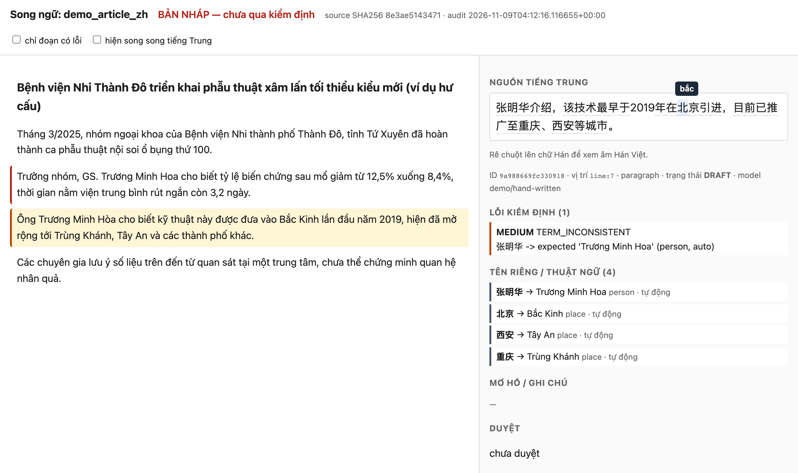
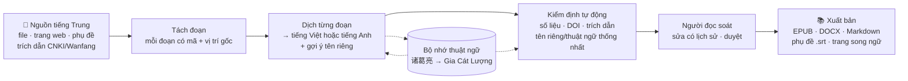
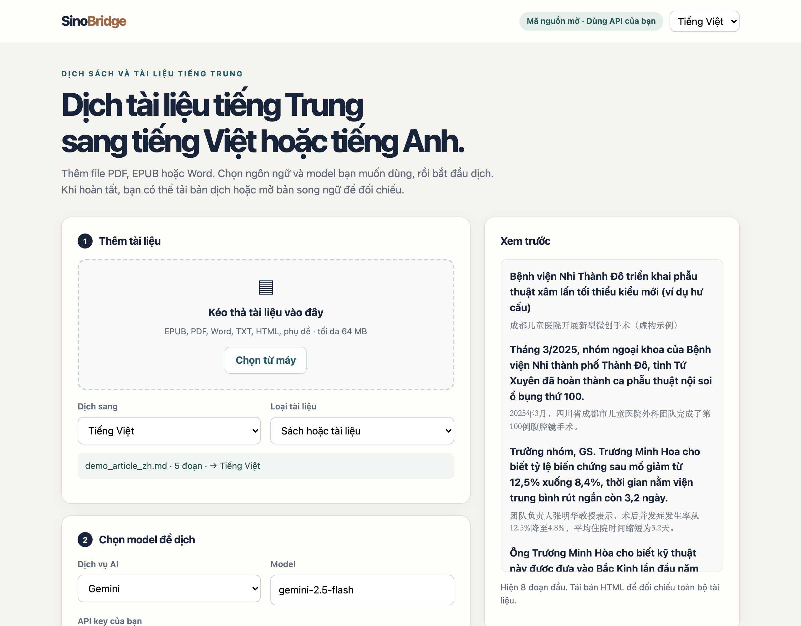
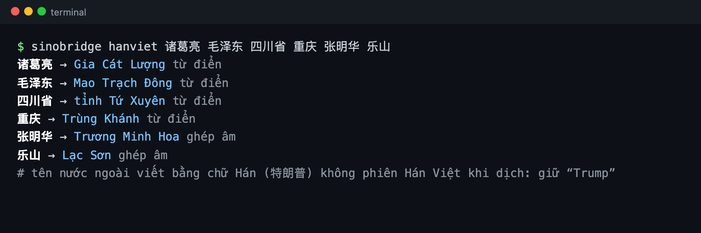
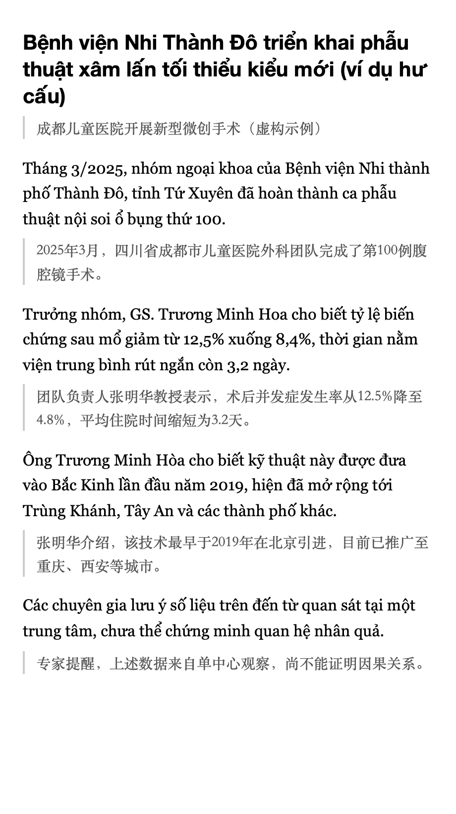

# SinoBridge

**Dịch sách và tài liệu tiếng Trung sang tiếng Việt hoặc tiếng Anh. Có thể đối chiếu từng đoạn với bản gốc.**

**Tiếng Việt** · [English](README.en.md)

**[Dùng thử trên web](https://tuyentran-md.github.io/sinobridge/)** · Dán key Gemini miễn phí (hoặc key GPT, DeepSeek, Qwen, OpenRouter) rồi dịch và đọc song song ngay trong trình duyệt; không có máy chủ trung gian. Không có key thì chạy model nhỏ trên máy (cần WebGPU). Xem [giới hạn của bản web](web/README.md).

SinoBridge là công cụ mã nguồn mở để dịch tài liệu trên máy tính. Bạn chọn file, ngôn ngữ và model AI đang sử dụng. Ứng dụng chia tài liệu thành các đoạn, hỗ trợ kiểm tra bản dịch và xuất file đọc. Dòng lệnh có thêm các chức năng dành cho nghiên cứu.

| Phần | Làm gì |
|---|---|
| **Nhập tài liệu** | Mở EPUB, PDF có lớp chữ, Word, TXT, Markdown, HTML và phụ đề. Dòng lệnh còn nhận trang web công khai và file trích dẫn xuất từ CNKI/Wanfang/VIP/SinoMed; không tự truy cập các kho trả phí. |
| **Dịch và kiểm tra** | Dịch sang tiếng Việt hoặc tiếng Anh bằng API key/model của người dùng hoặc Ollama trên máy. Bộ nhớ thuật ngữ giúp giữ cách gọi nhất quán; bộ kiểm tra tự động gắn cờ một số lỗi về số liệu và trích dẫn. |
| **Đọc và xuất file** | Tải EPUB, Word, Markdown, phụ đề hoặc trang HTML song ngữ. Chọn một đoạn để xem bản gốc, ghi chú kiểm tra và lịch sử sửa. |

*Ví dụ trang đối chiếu: đoạn sai số liệu được gắn viền đỏ. Khi chọn một đoạn, phần bên phải hiển thị bản gốc, thuật ngữ và ghi chú kiểm tra. Rê chuột lên chữ 北 để xem âm Hán Việt.*

## Cách hoạt động

Mỗi đoạn dịch có mã và vị trí trong nguồn (dòng, trang hoặc mốc thời gian phụ đề) để người đọc tìm lại đúng đoạn tiếng Trung.

## Cách dùng: kéo thả và dịch

1. Cài Python 3.10+ nếu máy chưa có. Trên GitHub, chọn Code → Download ZIP rồi giải nén.
2. Nhấp đúp file Start SinoBridge.command (macOS) hoặc Start SinoBridge.bat (Windows) trong thư mục scripts. Lần đầu ứng dụng cài thêm thư viện cần thiết.
3. Kéo thả file vào giao diện, chọn tiếng Việt hoặc tiếng Anh.
4. Chọn dịch vụ AI, nhập tên model và API key của bạn; hoặc chọn Ollama nếu đã cài model trên máy. Xác nhận trước khi gửi nội dung tới dịch vụ ngoài, rồi bấm **Dịch tài liệu**.
5. Tải EPUB, Word, Markdown hoặc bản HTML song ngữ. Các đoạn đã dịch được lưu lại nếu dừng giữa chừng.

Giao diện có tiếng Việt và tiếng Anh. Tài liệu lưu tại máy người dùng, trong thư mục .sinobridge/projects thuộc thư mục home. SinoBridge không tự đồng bộ tài liệu. Khi dùng API, nội dung được gửi tới dịch vụ AI đã chọn và phí (nếu có) do dịch vụ đó thu. API key không được lưu thành file.

Chi tiết cài đặt: [hướng dẫn cho người mới](docs/quickstart-gui.md). Ai quen dòng lệnh có thể chạy lệnh sinobridge serve --open.

## Cài đặt (dòng lệnh)

Python 3.10+.

    git clone https://github.com/tuyentran-md/sinobridge.git && cd sinobridge
    python3 -m venv .venv && . .venv/bin/activate
    pip install -e '.[all]'      # gồm hỗ trợ PDF và DOCX

## Dùng nhanh bằng dòng lệnh

Chọn ngôn ngữ đích khi nạp tài liệu: `--target vi` (mặc định) hoặc `--target en`.

    sinobridge sources                                    # xem các nguồn hỗ trợ
    sinobridge ingest sach.epub --workspace work/sach --kind book
    sinobridge ingest "https://zh.wikipedia.org/wiki/汉越词" --workspace work/wiki --kind article
    sinobridge ingest video.zh.srt --workspace work/video --kind subtitle
    sinobridge ingest paper.pdf --workspace work/paper-en --kind paper --target en   # dịch sang tiếng Anh

Dịch (mặc định 1 đoạn để thử; `--max-segments 0` = tất cả). Văn bản chỉ được gửi tới dịch vụ khi bạn bật
`--allow-external` sau khi đã kiểm tra quyền và tính riêng tư của tài liệu:

    export GEMINI_API_KEY=...        # hoặc OPENAI_API_KEY, DEEPSEEK_API_KEY, DASHSCOPE_API_KEY...
    sinobridge translate --workspace work/sach --provider gemini --model <model-flash> --allow-external --dry-run
    sinobridge translate --workspace work/sach --provider gemini --model <model-flash> --allow-external --max-segments 0
    sinobridge translate --workspace work/sach --provider openai --model <model-gpt> --allow-external

Dùng mô hình nào là lựa chọn của bạn: `openai`, `gemini`, `deepseek`, `qwen`, `openrouter`, `ollama`, hoặc bất kỳ
server tương thích OpenAI (`--provider openai-compatible --base-url ...`). Xem `.env.example`.

## Tên riêng và thuật ngữ: phiên âm Hán Việt

    sinobridge hanviet 诸葛亮 四川省 乐山
    # Gia Cát Lượng · tỉnh Tứ Xuyên · Lạc Sơn (乐 đa âm: chọn "lạc" nhờ pinyin lè của địa danh)
    sinobridge name 诸葛亮 张明华 --to en
    # Zhuge Liang · Zhang Minghua (dịch sang tiếng Anh: pinyin chuẩn hoặc tên tiếng Anh quen dùng)

- Tra từ điển tên và từ Hán Việt kèm sẵn trước (khoảng 11.600 mục từ Wiktionary và CVDICT), sau đó mới ghép âm
  từng chữ theo tần suất thực tế. Pinyin dùng để phân biệt chữ đa âm (行 xing → hành, hang → hàng).
- Dịch sang tiếng Anh: dùng tên tiếng Anh quen dùng nếu có (khoảng 17.000 tên riêng từ CC-CEDICT: Confucius, Tibet,
  Hong Kong); nếu không thì theo quy tắc pinyin (họ trước, tên viết liền: Zhang Minghua; địa danh: Xi'an, Sichuan Province).
- Độ chính xác (Hán Việt) đo trên tên không dùng để dựng dữ liệu: 88% đúng nguyên tên, 95% đúng từng âm. Chữ đa âm và chữ chưa
  biết âm luôn được gắn cờ để người kiểm tra.
- Khi dịch, mô hình được gợi ý sẵn các tên đã biết và phải liệt kê tên riêng và thuật ngữ nó gặp. Tên gốc Trung Quốc
  được chuẩn hoá về Hán Việt; tên nước ngoài phiên âm bằng chữ Hán (特朗普) giữ dạng quen dùng (Trump).

- **Bộ nhớ thuật ngữ** của từng dự án (`terms.json`) giữ cách dịch thống nhất từ chương 1 đến chương cuối. Kiểm định
  báo `TERM_INCONSISTENT` khi một đoạn dịch khác bộ nhớ.

      sinobridge terms scan --workspace work/sach                  # tên đã biết có trong sách, chưa cần gọi mô hình
      sinobridge terms set 诸葛亮 "Khổng Minh" --type person --workspace work/sach   # khoá cách dịch riêng
      sinobridge terms list --workspace work/sach

- Trang đọc song ngữ: rê chuột lên chữ Hán để xem âm Hán Việt; mỗi đoạn có danh sách tên/thuật ngữ và cách dịch đã
  thống nhất.
- Tuỳ chọn: `sinobridge data fetch` tải toàn bộ CVDICT (khoảng 11 MB) để có pinyin theo ngữ cảnh và nghĩa tiếng Việt
  của thuật ngữ.

Kiểm định, đọc, sửa, duyệt:

    sinobridge audit  --workspace work/sach --glossary examples/glossary.sample.json
    sinobridge export --workspace work/sach --format html --out out/doc-song-ngu.html
    sinobridge revise --workspace work/sach --segment <ID> --text "Câu sửa" --reviewer "Lan" \
                   --reason "Sai số liệu 58 -> 85" --severity HIGH
    sinobridge approve --workspace work/sach --segment <ID> --reviewer "Lan" --evidence "Đối chiếu bản gốc"

Xuất bản:

    sinobridge export --workspace work/sach  --format epub --out out/sach.epub
    sinobridge export --workspace work/sach  --format epub --bilingual --out out/sach-song-ngu.epub
    sinobridge export --workspace work/sach  --format docx --out out/sach.docx
    sinobridge export --workspace work/video --format srt  --out out/video.vi.srt

**EPUB song ngữ** (hình bên): mỗi đoạn tiếng Việt có đoạn tiếng Trung gốc ngay bên dưới, chia chương, có mục lục,
đạt chuẩn EPUBCheck. Bỏ `--bilingual` để có bản chỉ tiếng Việt.

Sản phẩm không có dấu "nháp" trên từng trang; trạng thái duyệt được ghi **một lần, trung thực** ở trang bản quyền
(ví dụ "Bản dịch nháp: 120/300 đoạn đã được người duyệt"). Mỗi đoạn vẫn có mã neo ẩn trỏ về đoạn gốc.
Với `--target en`, trang bản quyền, mục lục và trang đọc song ngữ dùng tiếng Anh.

 

## Tra cứu nghiên cứu tiếng Trung

    sinobridge search "先天性巨结肠" --source openalex --limit 10 --library mylib
    sinobridge library import cnki_export.ris --library mylib      # RIS / EndNote / NoteExpress
    sinobridge library list --library mylib --query 巨结肠
    sinobridge library link --library mylib --record <ID> --workspace work/paper1
    sinobridge library export --library mylib --out refs.ris        # mở bằng Zotero/EndNote

- OpenAlex trả về cả tóm tắt và link truy cập mở (OA) nếu có.
- **CNKI/Wanfang/VIP/SinoMed**: công cụ không đăng nhập hay cào dữ liệu. Ai có quyền truy cập thì tự xuất trích dẫn
  (RIS/EndNote/NoteExpress) và tải PDF, rồi `library import` + `ingest` file PDF. File `.caj` cần đổi sang PDF trước.
- Mạng xã hội cần đăng nhập (Weibo, Zhihu, Xiaohongshu, WeChat bị robots.txt chặn): mở bằng trình duyệt của bạn,
  *Lưu trang (HTML)*, rồi `ingest` file đã lưu.

## Nguyên tắc

- **Truy vết**: mỗi đoạn có mã, vị trí trong file gốc (dòng, trang, khối, mốc thời gian phụ đề), SHA-256 nguồn;
  trang web được lưu bản chụp (`source_snapshot.html`) vì nội dung web thay đổi.
- **Giới hạn kiểm tra tự động**: kiểm định tự động chỉ là bằng chứng một phần; không cổng ngữ nghĩa/khoa học nào
  tự động "PASS". Xem [chính sách QA](docs/qa-policy.md).
- **Quyền và riêng tư**: chỉ gửi văn bản ra API khi bạn bật `--allow-external`; không vượt paywall, không cào hàng loạt,
  tôn trọng robots.txt. Bản dịch không xoá bản quyền của tác giả gốc.
- Không dùng bản dịch tài liệu y khoa để kết luận lâm sàng khi chưa đọc nguồn gốc.
- So số theo giá trị: 1.25 = 1,25; 120万 = 1,2 triệu = 1.2 million; 2025年3月 = March 2025; 一百二十 = 120.

## Viết thêm nguồn (plugin)

Một package Python bất kỳ có thể thêm connector qua entry point `sinobridge.sources` — ví dụ API CNKI có
bản quyền của một trường, trình đọc file xuất Weibo, RSS. Xem [docs/connectors.md](docs/connectors.md).

## Lộ trình

Xem [ROADMAP.md](ROADMAP.md). Đóng góp: [CONTRIBUTING.md](CONTRIBUTING.md).

## English

Full English documentation: [README.en.md](README.en.md).

## Ghi công

Cảm hứng quy trình (trung thành, tự nhiên, kiểm định nhiều cổng, truy vết) từ
[prompt dịch How To Live Better](https://thuongtin.notion.site/Prompt-d-ch-How-To-Live-Better-t-ti-ng-Trung-sang-ti-ng-Vi-t-41172ac96186819dae67c730db8d7152)
và [thuongtin/HowToLiveBetter](https://github.com/thuongtin/HowToLiveBetter) (CC BY 4.0). Mã nguồn được viết độc lập,
giấy phép MIT.

Dữ liệu ngôn ngữ kèm theo (`src/sinobridge/data/`) dựng từ Wiktionary (qua kaikki.org), CVDICT của Phong Phan,
CC-CEDICT (MDBG) và Unicode Unihan; phát hành theo **CC BY-SA 4.0** (file dựng từ Unihan theo Unicode License), xem
[src/sinobridge/data/README.md](src/sinobridge/data/README.md).

Ảnh minh hoạ dùng bài viết hư cấu trong `examples/demo_article_zh.md`, tạo lại bằng
`python3 scripts/make_readme_images.py` (cần Playwright).

## Kiểm thử

    python3 -m unittest discover -s tests -v
